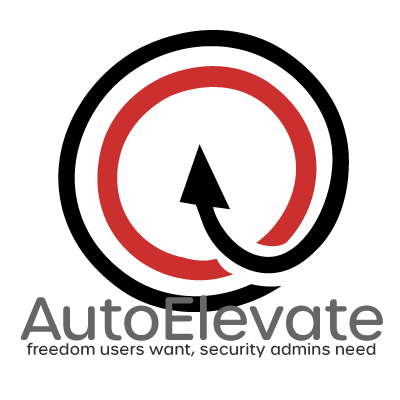

# n8n-nodes-autoelevate



[](https://www.npmjs.com/package/@joshuanode/n8n-nodes-autoelevate)
[](https://opensource.org/licenses/MIT)
[](https://n8n.io/)
[](https://github.com/ajoshuasmith/n8n-nodes-autoelevate)
[](https://partner-api-docs.autoelevate.com/)

An n8n community node for the [AutoElevate Partner API](https://partner-api-docs.autoelevate.com/), providing MSP automation for endpoint inventory, elevation activity, approval workflows, and partner usage.

[n8n](https://n8n.io/) is a workflow automation platform that lets you connect AutoElevate to your PSA, reporting, security, and notification workflows.

## AutoElevate API Beta Status

> **Beta notice:** AutoElevate identifies its [Partner API](https://partner-api-docs.autoelevate.com/) as **beta** and states that it may change without notice. This node pins requests to `/api/v1` and automatically sends the mandatory beta acknowledgment header required by the API. Test workflows before using approval or denial actions in production.

## Features

- Operations for every endpoint in the Partner API v1 specification retrieved on 2026-10-27
- API Token (`AE-BEARER`) and signed HMAC (`AE-HMAC-SHA256`) authentication
- Searchable company, computer, location, event, session, request, rule, user, role, and webhook selectors
- Automatic offset and cursor pagination
- Picker searches that scan all available API pages when AutoElevate has no server-side search parameter
- Automatic `429` retries honoring `Retry-After`
- Server-side company, location, computer, status, approval-state, action, entity-type, and date filters
- n8n item pairing and **Continue On Fail** support
- Actionable errors for authentication, permissions, missing records, and rate limits

## Installation

Follow the [n8n community-node installation guide](https://docs.n8n.io/integrations/community-nodes/installation/).

### Community Nodes

1. In n8n, go to **Settings → Community Nodes**.
2. Select **Install**.
3. Enter `@joshuanode/n8n-nodes-autoelevate`.
4. Accept the community-node risk notice and install the package.

### Manual Installation

In a self-hosted n8n installation:

```bash
npm install @joshuanode/n8n-nodes-autoelevate
```

Restart n8n after installation if the node does not appear immediately.

### Testing prereleases

In a test n8n instance, open **Settings > Community Nodes > Install** and enter the exact version:

```text
@joshuanode/n8n-nodes-autoelevate@0.2.0-beta.3
```

The `next` tag selects the current testing release. n8n resolves a tag at installation time; it does not keep following that tag for later updates. Pin the exact version when reproducing a test result.

Start with read operations and a narrowly scoped API key. Test changes to users, rules, and computer modes against disposable records before enabling them in scheduled workflows. Computer actions apply asynchronously, so confirm the reported state with **Computer: Get**.

## Prerequisites

- An AutoElevate partner account with access to the Partner API
- An AutoElevate service user
- An API key with the permissions required by your workflows
- n8n 1.0 or newer
- Node.js 18.17.0 or newer for self-hosted installations

## Credentials

In the AutoElevate admin portal, open a **service user** and create an API key. Grant only the permissions needed by your workflows.

### API Token (recommended)

1. Create a key using the **API Token (AE-BEARER)** scheme.
2. Copy the `aeb_` token when it is displayed.
3. In n8n, create an **AutoElevate Partner API** credential.
4. Select **API Token (AE-BEARER)** and paste the token.

### HMAC

1. Create a key using the **HMAC (AE-HMAC-SHA256)** scheme.
2. Copy both the `aeh_` wire token and the separate HMAC signing key.
3. In n8n, select **HMAC (AE-HMAC-SHA256)** and enter both values.

AutoElevate displays secrets only once. Store them securely and revoke any key that may have been exposed.

## Resources and Operations

| Resource | Operations | Filters |
| --- | --- | --- |
| Audit Log | Get Many | Entity type, action, start, end |
| Company | Get, Get Many | — |
| Computer | Get, Get Many, Set Elevation Mode, Set Technician Mode, Delete | Company, location |
| Elevated Session | Get, Get Many | Company, computer, status |
| Elevation Event | Get, Get Many | Company, start, end |
| Elevation Request | Approve, Deny, Get, Get Many | Company, approval state, start, end |
| Elevation Rule | Get, Get Many, Update, Delete | Company |
| Location | Get, Get Many | Company |
| Role | Get, Get Many | — |
| Usage | Get | — |
| User | Get, Get Many, Create, Update, Delete | — |
| Webhook | Get, Get Many, Create, Update, Delete, Get Delivery Logs, Test | — |

## Example Workflows

### Notify on Pending Elevation Requests

```text
Resource: Elevation Request
Operation: Get Many
Approval State: Pending
Return All: true
```

Run this on a schedule, then route each request to Slack, Teams, email, or your PSA.

### Approve a Request

```text
Resource: Elevation Request
Operation: Approve
Elevation Request: Select from list or provide a UUID
Elevation Type: Admin
Create Rule: false
```

Enable **Create Rule** only when you intentionally want future matching requests handled automatically.

### Inventory Computers for a Company

```text
Resource: Computer
Operation: Get Many
Company: Select from list
Return All: true
```

## Computer actions

**Set Elevation Mode** accepts `audit`, `live`, `policy`, or `inherit`. Inherit clears the computer override and restores its location, company, or MSP setting. **Set Technician Mode** turns technician mode on or off on supported Windows computers. Activity is attributed to the API token owner; use individual technician tokens when individual attribution is required.

Changes apply on the next agent configuration check-in (4.5 minutes by default). The node returns the API response, including its pending state. An accepted response does not confirm activation. Use **Computer: Get** to confirm the reported `elevationMode`; technician mode reports `technicianBypass`.

**Delete** queues agent uninstall and hides the computer record. It can reappear if the agent checks in before uninstalling. Elevation history and audit entries remain. Delete operations require **Confirm Deletion**.

## Rule and user updates

**Update Fields** sends only selected fields. Omitted fields stay unchanged, and boolean `false` is preserved. For elevation rules, an empty Friendly Name or Notes clears that field with `null`. Identification Criteria accepts a JSON object using the structure returned by **Get**; its internal shape is not part of the public API contract. Rule scope cannot be edited. New rules can be created through **Elevation Request: Approve/Deny** with **Create Rule**, but there is no standalone rule-create endpoint.

**User: Create** creates human users. Service users must be created in the Admin Portal. Select a role and company access: all, none, selected companies only, or all except selected companies. On update, Company Access defaults to **Leave Unchanged**. Choosing another value replaces the complete access setting. Email and user kind cannot be changed through this API.

For elevated-session approvals, set Duration to 1–60 minutes; Addigy-managed Macs require at least 10. Leaving Duration at 0 omits it, which is only suitable for other request types. **Deny** supports a reason shown to the end user. Just-in-Time Log In approvals still require the mobile app.

## Webhooks

**Webhook: Create** registers an HTTPS destination and event subscriptions. Native JSON deliveries carry HMAC signatures. Verify the timestamp and signature against the raw request body before processing, then deduplicate by `deliveryId`. Teams and Slack formats are unsigned. User events require a webhook scoped to all companies.

Creation returns `{ webhookConfiguration, secret }`; the new ID is at `webhookConfiguration.id`. Save the signing secret securely and account for n8n execution-data retention, because the creation response is node output. Later reads return only the destination URL origin and omit the secret. When updating, omit URL to preserve it; do not copy the redacted URL from Get. Adding an empty Company field to an update explicitly restores all-company scope.

**Get Delivery Logs** returns the most recent attempts (up to 50). **Test** sends a real test delivery even if the webhook is disabled. A newly created webhook may briefly return 404 on subsequent calls; retry after it becomes visible. This package manages webhook subscriptions; use n8n's Webhook node to receive events.

## API Limits

The [Partner API reference](https://partner-api-docs.autoelevate.com/) documents a default limit of **20 requests per minute per MSP, HTTP method, and route path** (checked 2026-10-27). Capacity refills continuously, roughly one request every three seconds. Limits may change during beta; honor the server's `Retry-After` response.

**Get Many** uses pages of up to 200 records, so large result sets consume multiple requests. A `429` response includes a `Retry-After` value.

Canceling an execution stops further input items, pagination, and rate-limit retries. HTTP requests have a 30-second timeout. On older n8n versions that cannot abort an HTTP request, one request already in flight may finish after cancellation, but the node stops waiting and sends no further requests.

## Error Handling and Troubleshooting

| Error | Meaning | Recommended action |
| --- | --- | --- |
| `400 Bad Request` | Invalid parameters or a changed beta API contract | Review the node fields and compare the request with the current AutoElevate documentation |
| `401 Unauthorized` | Invalid, expired, or incorrectly configured API credentials | Confirm the selected authentication scheme and rotate the API key if needed |
| `403 Forbidden` | The service user or API key lacks permission for the operation | Add the required API permission in AutoElevate or use a properly scoped service user |
| `404 Not Found` | The record does not exist or is outside the partner account | Verify the selected company, computer, location, session, request, or rule |
| `409 Conflict` | The resource state prevents this operation | Re-read the record; requests may already be resolved or multiple users may be signed in |
| `422 Unprocessable Entity` | The target cannot apply the operation | Check platform support, agent state, session duration, and rule constraints |
| `429 Too Many Requests` | The API rate limit has been reached | The node retries twice using `Retry-After`; reduce polling frequency or batch size if the limit persists |

AutoElevate error messages and error codes are preserved in n8n when the API returns them. For example, a missing audit-log permission should surface AutoElevate's original authorization message rather than a generic request failure.

### Node Does Not Appear

- Restart n8n after installing the package.
- Confirm `@joshuanode/n8n-nodes-autoelevate` appears under **Settings → Community Nodes**.
- For Docker deployments, confirm the package is installed in the same environment and user context that runs n8n.

### Picker Search Is Slow

The Partner API does not currently expose server-side search parameters for picker resources. When search text is entered, the node scans all available API pages and filters the results locally. Large partner accounts may therefore consume several requests while searching.

## Compatibility

- n8n: 1.0 or newer
- Node.js: 18.17.0 or newer
- AutoElevate Partner API: v1 beta

## Development

```bash
npm install
npm run build
npm run lint
npm test
npm pack --dry-run
```

For local n8n testing, use `npm link` or install the generated package tarball in your test instance.

> **Workflow type warning:** Loading the node directly from n8n's custom-node directory registers it as `CUSTOM.autoElevate`. Installing the published package registers it as `@joshuanode/n8n-nodes-autoelevate.autoElevate`. Workflows created with the custom-directory build must have that node type migrated before they can use the npm-installed package. For durable test workflows, install the generated package tarball instead of loading the source directory as a custom node.

## Security

- Use a dedicated AutoElevate service user.
- Prefer short-lived API keys for testing.
- Scope keys to least privilege.
- Never commit API tokens or HMAC signing keys.
- Treat elevation approval and rule creation as privileged actions.

Please report security issues privately rather than opening a public issue containing credentials or customer data.

## Contributing

Bug reports, feature requests, and pull requests are welcome in the [GitHub repository](https://github.com/ajoshuasmith/n8n-nodes-autoelevate).

## Support

- For node bugs or feature requests, open a [GitHub issue](https://github.com/ajoshuasmith/n8n-nodes-autoelevate/issues).
- For AutoElevate account access, API permissions, or platform behavior, contact AutoElevate support.
- Do not include API keys, HMAC signing keys, customer names, computer names, or other sensitive tenant data in public issues.

## Version History

### 0.2.0-beta.3

- Stop further API requests when an execution is canceled, including during rate-limit backoff
- Limit individual HTTP requests to 30 seconds
- Document the webhook creation response and its ID field

### 0.2.0-beta.2

- Fixed a required Role selector blocking unrelated operations before execution
- Added regression tests using n8n's own parameter validation

### 0.2.0-beta.1

- Added computer elevation-mode and technician-mode controls, plus agent uninstall and deletion
- Added user management, company access settings, and role lookup
- Added elevation rule get, update, and delete operations
- Added webhook management, test deliveries, and delivery logs
- Added individual elevation event lookup, denial reasons, withdrawn-request filtering, and rule audit filtering
- Updated API limits and session-duration guidance
- Added offline execution tests against the API contract retrieved on 2026-10-27

### 0.1.0

- Initial public release
- Covered the AutoElevate Partner API v1 beta endpoints available at the initial release
- Bearer and HMAC authentication
- Searchable resource selectors, pagination, filtering, rate-limit retries, and preserved API errors

## Resources

- [AutoElevate Partner API documentation](https://partner-api-docs.autoelevate.com/)
- [n8n Community Nodes documentation](https://docs.n8n.io/integrations/community-nodes/)
- [n8n Community Nodes installation guide](https://docs.n8n.io/integrations/community-nodes/installation/)

## Author

Joshua Smith

## License

[MIT](LICENSE)

## Disclaimer

This is an independent community integration and is not an official AutoElevate product. AutoElevate is a trademark of its respective owner. Use of the AutoElevate Partner API remains subject to AutoElevate's terms, permissions, rate limits, and beta API conditions.
